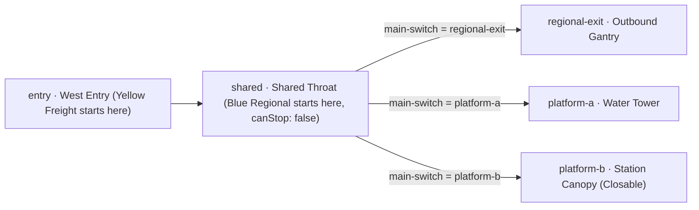

# Switchyard · 3D Railway WebMCP Demo

Switchyard is an interactive 3D miniature railway diorama demonstrating browser-native **WebMCP** (`document.modelContext`) orchestration with **TypeScript**, **Vite**, **Three.js**, and **`@w3c/webmcp-polyfill`**.

Click trains, platforms, tracks, or the yard switch directly in the 3D scene to place ordered numbered pins (`#1`, `#2`, `#3`...) with optional notes, then ask your browser AI agent to operate the railway via WebMCP tools only (there are no manual train/switch buttons on the main diorama).

---

## Architecture

| Component            | Module                     | Responsibility                                                                                                                                                                                                                                |
| -------------------- | -------------------------- | --------------------------------------------------------------------------------------------------------------------------------------------------------------------------------------------------------------------------------------------- |
| Simulation Engine    | `src/engine/`              | Pure TypeScript single source of truth for track topology, occupancy, reservations, branch closures, turnout interlocking, ordered multi-annotations, and epoch-guarded movement.                                                             |
| 3D Diorama           | `src/scene/`               | Scale-model Three.js yard (diesel freight consist + flatcar, electric regional EMU with pantograph, Water Tower, Butterfly Station Canopy, Signal Box, Outbound Gantry, conifers, clickable 3D Branch B gate, and 3D-anchored `#1..#N` pins). |
| WebMCP Adapter       | `src/webmcp/`              | Detects native `document.modelContext` / legacy `navigator.modelContext` before installing `@w3c/webmcp-polyfill`; registers `get_scene`, `set_switch`, and `move_train` with Gemini/Chrome-compatible schemas before `window.onload`.        |
| Spatial Floating HUD | `src/ui/`                  | Full-bleed viewport overlay with WebMCP status/Chrome flag helper, `#1..#N` annotation chips + inline notes, Branch B barrier switch, Reset, and live WebMCP call log.                                                                        |
| Browser Probe        | `probe.html`, `src/probe/` | Step 1 minimal compatibility probe with two selectable objects (`object-alpha`, `object-beta`) and `get_probe_state` / `color_object` tools.                                                                                                  |

---

## Yard Topology



- `shared` is a transit-only switch throat (`canStop: false`).
- `main-switch` starts aligned to `regional-exit` and is interlocked while `shared` is occupied or reserved.
- Dispatching `blue` to `regional-exit` clears `shared` without throwing the switch, unlocking `set_switch` for both Run 1 (`platform-a`) and Run 2 (`platform-b`).

---

## WebMCP Tool Contracts

### Main Diorama (`/`)

| Tool                                 | Annotations          | Contract                                                                                                                                                                                                                                                                           |
| ------------------------------------ | -------------------- | ---------------------------------------------------------------------------------------------------------------------------------------------------------------------------------------------------------------------------------------------------------------------------------- |
| `get_scene()`                        | `readOnlyHint: true` | Zero-arg read query returning ordered `annotations` (`#1`, `#2`, ... with optional `note` and live `locationTrackId`), derived `selectedTrainId` / `pinnedDestinationId`, trains (`yellow`, `blue`), track connections, occupancy/reservations, closures, and `main-switch` state. |
| `set_switch(switchId, branchId)`     | _(omitted)_          | Aligns `main-switch` to `regional-exit`, `platform-a`, or `platform-b` when `shared` is unoccupied and unreserved. Resolves structured `{ ok: false, code, affectedTrackId, retryable }` on lock.                                                                                  |
| `move_train(trainId, destinationId)` | _(omitted)_          | Validates route openness, clearance, and switch alignment; reserves traversed segments; awaits arrival animation; resolves arrival or structured blocking reason (`TRACK_CLOSED`, `TRACK_OCCUPIED`, `SWITCH_NOT_ALIGNED`).                                                         |

### Step 1 Browser Probe (`/probe.html`)

| Tool                            | Annotations          | Contract                                                                                 |
| ------------------------------- | -------------------- | ---------------------------------------------------------------------------------------- |
| `get_probe_state()`             | `readOnlyHint: true` | Returns `selectedObjectId` (`object-alpha`, `object-beta`, or `null`) and object colors. |
| `color_object(objectId, color)` | _(omitted)_          | Applies a CSS color to the specified object ID without relying on manual DOM buttons.    |

---

## Setup & Commands

```sh
pnpm install
pnpm dev
```

Available scripts:

- `pnpm dev` — Start Vite dev server (`/` and `/probe.html`)
- `pnpm lint` — Run Biome lint, import organization, and format checks (`biome check .`)
- `pnpm lint:fix` — Auto-fix safe Biome lint and formatting issues
- `pnpm format` — Format files with Biome (`biome format --write .`)
- `pnpm typecheck` — Run `tsc --noEmit`
- `pnpm test` — Run Vitest unit & WebMCP integration tests
- `pnpm build` — Typecheck and build multi-page bundle into `dist/`
- `pnpm preview` — Serve the production `dist/` bundle locally

---

## GitHub Pages Deployment

`.github/workflows/deploy.yml` runs `pnpm lint`, `pnpm typecheck`, `pnpm test`, and `pnpm build` on pushes and pull requests to `main`, and publishes `dist/` to GitHub Pages on `main` (all actions pinned by full commit SHA).

To enable deployment on GitHub:

1. Open **Settings → Pages → Build and deployment** in the repository.
2. Set **Source** to **GitHub Actions**.
3. Push to `main` (or trigger the workflow manually from **Actions → CI & Deploy GitHub Pages**). Vite is configured with `base: "./"` so the app and `./probe.html` work under the repository subpath (`https://puppo.github.io/switchyard/`).

---

## Browser Configuration (Chrome & Extensions)

1. **Using Chrome Extensions (e.g. _WebMCP - Model Context Tool Inspector_) or Native Chrome Agent**:
   - Open `chrome://flags/#enable-webmcp-testing`, set **WebMCP for testing** to **Enabled**, and relaunch Chrome.
   - Open Switchyard (`http://localhost:5179/` or `5173`). The top-left HUD pill should display **`● WebMCP Native Active`**.
   - Without that Chrome flag enabled, `@w3c/webmcp-polyfill` runs purely inside the page's JavaScript world (`⚠ Polyfill Mode · Enable Chrome Flag`), which Isolated-World Chrome content scripts cannot inspect.
2. **Step 1 Target-Browser Probe (`/probe.html`)**:
   - Open `/probe.html` in the target browser, select `object-alpha` or `object-beta`, and ask the agent: **"Color this green."**
   - Verify in the Probe Log that `get_probe_state` read your selection and `color_object` targeted that ID.

---

## Multi-Annotation Demo Workflow

1. **Place Numbered Pins (`#1`, `#2`, `#3`...) with Inline Notes**:
   - Click **Yellow Freight** or **Blue Regional** in the 3D diorama -> drops pin `#1` directly above the train with an inline note input.
   - Click **Platform A (Water Tower)** -> drops pin `#2` with an inline note input (edit notes right on the 3D pins — no separate list panel).
   - Optionally pin any other train, platform, track, or `main-switch` (`#3`, `#4`...).
2. **Send Prompt to Your Browser Agent**:
   - Yellow to Platform A: `"Move this train here. Dispatch the blue regional train first."`
   - Blue Regional directly to Platform A: `"Move #1 to #2."` (because `blue` sits idle ahead of `main-switch`, the switch aligns directly to `platform-a` and routes `blue` there).
3. **Reset & Run 2**:
   - Click **Reset** in the top-right HUD, pin **Yellow** (`#1`) and **Platform B** (`#2`), and repeat the prompt.
4. **Closure & Missing-Pin Checks**:
   - Click the **3D red/white barrier** on Branch B (or toggle **Branch B** in the top-right HUD) to close `platform-b`: `move_train("yellow", "platform-b")` returns `TRACK_CLOSED` and leaves `yellow` on `entry`.

---

## Verification Status

- **Automated Checks (`pnpm lint`, `pnpm typecheck`, `pnpm test`, `pnpm build`)**: Verified with Biome checks and `tests/engine.test.ts` + `tests/webmcp.test.ts` covering occupancy, reservations, switch interlocking, throat guard, Branch B closure precedence, mid-move `reset()` epoch safety, `AbortSignal` rollback, multi-annotations (`#1..#N` + notes + re-indexing), Gemini-compatible schema checks, and `@w3c/webmcp-polyfill` execution.
- **Live Browser Verification**: Verified in headless Chromium against the running Vite dev server (`http://localhost:5179/`).
- **External Browser Agents (ChatGPT Browser / Chrome Extension with `chrome://flags/#enable-webmcp-testing`)**: Must be tested interactively in your own Chrome / ChatGPT browser session.
